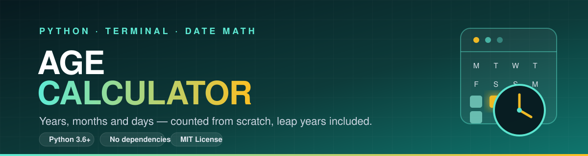
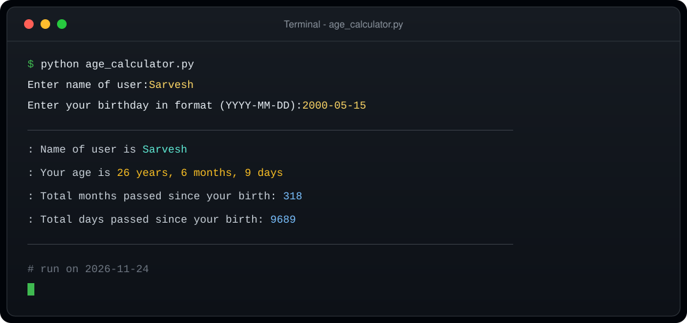
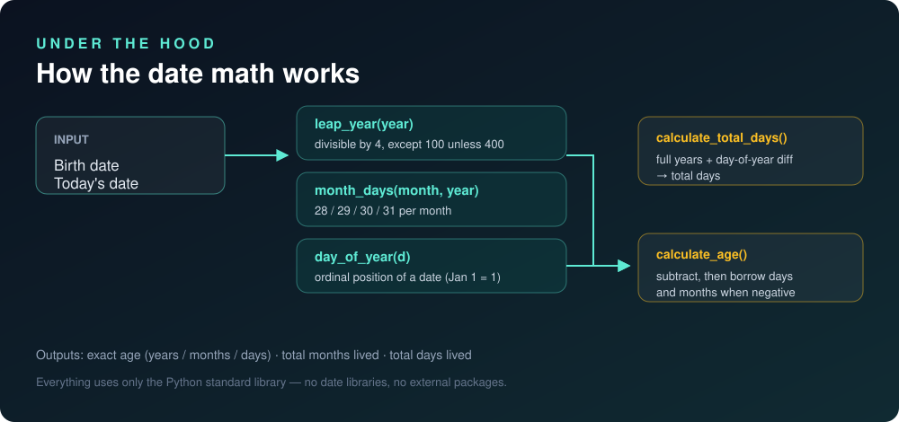

<div align="center">



# Age Calculator

**Your life, measured in years, months, days — and every single day in between.**

[](https://www.python.org/)
[](LICENSE)
[](#requirements)
[](#how-to-run)
[](https://github.com/sarveshkamdi7-collab)

</div>

## Overview

Age Calculator is a small command-line Python program that asks for your name and date of birth, then reports:

- your exact age in **years, months and days**
- the **total number of months** you have lived
- the **total number of days** you have lived

The interesting part is *how* it gets there. Instead of leaning on `datetime` subtraction, the date arithmetic is written by hand with functions for leap years, days-per-month and day-of-year. That makes this a compact practice project for loops, functions, conditionals and calendar logic — while still giving correct answers for edge cases like leap days and birthdays that have not happened yet this year.

The whole program lives in one Python file, uses only the standard library, and needs no setup beyond having Python installed.

## Demo



<details>
<summary>View the session as plain text</summary>

```text
$ python age_calculator.py
Enter name of user: Sarvesh
Enter your birthday in format (YYYY-MM-DD): 2000-05-15
____________________________________________________________________________

: Name of user is Sarvesh

: Your age is 26 years, 6 months, 9 days

: Total months passed since your birth: 318

: Total days passed since your birth: 9689
____________________________________________________________________________
```

Sample run recorded on **2026-11-24**.

</details>

## Features

- Exact age breakdown into **years, months and days**
- **Total months** lived (`years * 12 + months`)
- **Total days** lived, counted across all intervening years
- Correct **leap-year** handling (divisible by 4, except century years unless divisible by 400)
- Correct **month lengths**, including 29 days in a February of a leap year
- Handles birthdays that have **not yet occurred** in the current year by borrowing days and months
- Clear, aligned console output with separator lines
- **Zero third-party dependencies** — standard library only
- Beginner-friendly, readable single-file code

## How It Works



The calculation is split into small, reusable functions:

| Function | Purpose |
| --- | --- |
| `leap_year(year)` | Returns `True` for a leap year using the 4 / 100 / 400 rule |
| `month_days(month, year)` | Returns 28, 29, 30 or 31 for a month; raises `ValueError` for values outside 1-12 |
| `day_of_year(d)` | Returns the ordinal position of a date inside its year (January 1 = 1) |
| `calculate_total_days(birth, current)` | Adds the length of every full year in between, then adjusts with the day-of-year difference |
| `calculate_age(birth, current)` | Subtracts year/month/day components and borrows when a component goes negative |

Step by step:

1. The user's name and birthday (`YYYY-MM-DD`) are read with `input()` and parsed with `datetime.strptime()`.
2. `calculate_age()` subtracts the components. If the day is negative, one month is borrowed using the previous month's real length; if the month is negative, one year is borrowed as 12 months.
3. `calculate_total_days()` walks year by year from the birth year to the current year, adding 366 or 365 depending on `leap_year()`, then adds the difference between today's and the birthday's day-of-year.
4. Total months are derived from the age result, and all four values are printed.

## Requirements

- **Python 3.6 or newer** (the source uses f-strings)
- Standard library only — just `datetime` from the built-in modules
- Any terminal, command prompt or IDE console that supports interactive input

## How to Run

```bash
git clone https://github.com/sarveshkamdi7-collab/AgeCalculator.git
cd AgeCalculator
python age_calculator.py
```

On some systems the Python command is `python3`:

```bash
python3 age_calculator.py
```

Prefer no Git? Download `age_calculator.py` and run it directly with `python age_calculator.py`.

When prompted, enter your name and then your birthday in `YYYY-MM-DD` format, for example `2000-05-15`.

## Sample Output

```text
Enter name of user: Sarvesh
Enter your birthday in format (YYYY-MM-DD): 2000-05-15
____________________________________________________________________________

: Name of user is Sarvesh

: Your age is 26 years, 6 months, 9 days

: Total months passed since your birth: 318

: Total days passed since your birth: 9689
____________________________________________________________________________
```

## Project Structure

```text
AgeCalculator/
├── assets/
│   ├── banner.svg          # Repository banner
│   ├── demo.svg            # Illustrated terminal session
│   └── logic.svg           # Date-calculation flow diagram
├── LICENSE                 # MIT License
├── README.md               # This documentation
└── age_calculator.py       # Complete program source
```

## Concepts Used

- `input()` for interactive console input
- `datetime.strptime()` and `date.today()` from the standard library
- Functions with parameters and return values
- `if / elif / else` branching and `for` / `while` loops
- Borrowing across month and year boundaries
- f-strings for readable error messages
- Manual calendar arithmetic: leap years, month lengths and day-of-year

## Roadmap

The code is intentionally simple so it stays easy to read. Ideas for future versions:

- Re-prompt on invalid date input instead of exiting with an error
- Reject birthdays in the future
- Wrap the logic in a `main()` function with an `if __name__ == "__main__":` guard
- Add unit tests with the built-in `unittest` module
- Add more ways to display the result (weeks, hours, minutes)

## License

Released under the [MIT License](LICENSE). Feel free to use, modify and share it.

## Author & Contributor

- **Sarvesh Kamdi** — [GitHub: sarveshkamdi7-collab](https://github.com/sarveshkamdi7-collab) — sarveshkamdi7@gmail.com
- This repository is authored and maintained by **sarveshkamdi7-collab**.
